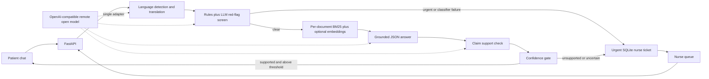

# CareBridge

CareBridge is a safety-first, multilingual discharge-document explainer with a nurse handoff queue. Patients can ask questions about a synthetic discharge sheet in English, Telugu, Hindi, or supported Latin-script code-mixed text; the service retrieves only that patient's document, answers with citations only when the evidence and confidence gate support it, and otherwise escalates the full context to a nurse. It is a hackathon demonstration, not a clinical service.

## Problem and user

Patients may leave a procedure with written instructions that are difficult to understand. CareBridge demonstrates a narrow alternative to open-ended medical chat: explain only the patient's own supplied instructions, surface uncertainty instead of guessing, detect urgent language, and make human review visible. The only built-in records are fictional.

## Architecture



## How the confidence gate works

The gate combines document retrieval strength (top score and separation from the next passage), claim-grounding support, consistency across up to three answer samples, and translation consistency for non-English input. A logistic model maps the normalized signals to a confidence value. English requests omit the translation signal and renormalize the remaining weights. If generation says the document cannot answer, translation fails, the model output is invalid, or confidence is below `GATE_THRESHOLD`, CareBridge withholds the draft answer and creates a ticket. `GATE_ENABLED=false` is available only to measure an explicit no-gate evaluation baseline; do not use it for a patient-facing deployment. Default weights are in `app/config.py`; `eval/calibrate.py` can fit dev-only weights.

## Safety and scope

- **Unsupported responses:** The assistant uses only passages retrieved from the selected synthetic discharge sheet. Missing instructions are not filled from general knowledge; the patient is told that the sheet does not safely answer and a nurse ticket is created.
- **Sensitive information:** The bundled data is synthetic. Do not enter names, dates of birth, addresses, real medical records, or other personal/health information. No real-patient data should be added to the repository.
- **Uncertain results:** Low grounding, inconsistent generations, translation problems, retrieval ambiguity, or an unavailable red-flag classifier cause escalation. The red-flag classifier fails safe: when its remote call fails, it creates an urgent ticket.
- **High-risk decisions:** Red-flag messages receive an urgent localized handoff message and an urgent nurse ticket, with no generated medical answer. CareBridge does not diagnose, advise a medication change, or replace emergency services. The default emergency contact wording is a placeholder; configure only locally verified information.
- **Human review:** Tickets preserve the original and English question, evidence passages, model draft when applicable, confidence signals, and escalation reason. A nurse can reply and resolve the ticket. Telugu and Hindi rule lists and seed examples were machine-assisted and must be reviewed by fluent speakers before any real use.
- **Scope:** CareBridge helps patients understand an existing discharge document; it is not a diagnostic or treatment tool.

## Local setup in five commands

Run these in PowerShell from the project root. Python 3.11 is the supported runtime.

```powershell
py -3.11 -m venv .venv
.\.venv\Scripts\Activate.ps1
python -m pip install --upgrade pip
Copy-Item .env.example .env; python -m pip install -r requirements.txt
uvicorn app.main:app --reload
```

The app is at `http://localhost:8000`; the nurse page is at `/nurse`. The default no-endpoint demo is deterministic and extractive for English requests. Non-English questions require a configured translation model; if translation is unavailable, the safe behavior is escalation. For an OpenAI-compatible AMD-hosted endpoint, set `LLM_BASE_URL`, `LLM_API_KEY`, and `LLM_MODEL` in `.env`. Never commit `.env`.

## Configuration

All settings are environment variables. `.env.example` contains each supported setting.

| Variable | Default | Purpose |
|---|---|---|
| `APP_NAME` | `CareBridge` | Service display name |
| `ENVIRONMENT` | `demo` | Deployment environment label |
| `LLM_BASE_URL` | unset | OpenAI-compatible chat-completions base URL |
| `LLM_API_KEY` | unset | Endpoint credential; keep secret |
| `LLM_MODEL` | `Qwen2.5-7B-Instruct` | Remote open model name |
| `LLM_TIMEOUT_SECONDS` | `20` | Model request timeout |
| `LLM_MAX_RETRIES` | `2` | Remote request retries with backoff |
| `GATE_ENABLED` | `true` | Enable the patient-facing confidence gate |
| `GATE_THRESHOLD` | `0.65` | Minimum confidence for an answer |
| `CONSISTENCY_SAMPLES` | `3` | Maximum parallel answer samples |
| `EMBEDDINGS_ENABLED` | `true` | Enable optional sentence embeddings |
| `EMBEDDING_MODEL` | `sentence-transformers/all-MiniLM-L6-v2` | CPU retrieval and similarity model |
| `DATABASE_URL` | `sqlite:///./data/carebridge.db` | SQLAlchemy ticket/metrics database |
| `PATIENTS_FILE` | `data/patients.json` | Synthetic patient-to-document mapping |
| `DOCS_DIR` | `data/docs` | Synthetic discharge documents |
| `REDFLAGS_DIR` | `data/redflags` | Multilingual rule lists |
| `GATE_WEIGHTS_FILE` | `eval/gate_weights.json` | Optional dev-calibrated gate weights |
| `NURSE_PASSWORD` | unset | Optional HTTP Basic password for nurse routes |
| `CORS_ORIGINS` | `http://localhost:8000` | Comma-separated allowed browser origins |
| `REQUESTS_PER_MINUTE` | `20` | Per-client in-memory chat rate limit |
| `MAX_MESSAGE_LENGTH` | `1000` | Maximum accepted question length |
| `EMERGENCY_CONTACT_TEXT` | `your locally verified emergency services` | Placeholder/localized emergency contact text |
| `BACKEND` | `local` | `local` or `evolus` adapter selection |
| `EVOLUS_BASE_URL` | unset | Evolus API base URL |
| `EVOLUS_API_KEY` | unset | Evolus API credential; keep secret |
| `EVOLUS_WORKSPACE_ID` | unset | Evolus workspace identifier |
| `AMD_SERVED` | `false` | Set true only when the configured model is actually served on AMD hardware |
| `SQLITE_VOLUME_PATH` | `carebridge-data` | Compose named volume or host bind path for SQLite |

## Tests, evaluation, and benchmark

```powershell
python -m pytest -q
ruff check app eval tests scripts
python -m eval.seed_questions
python -m eval.run_eval --split dev
python -m eval.calibrate --input eval/dev_predictions.jsonl --target-error-rate 0.05
python -m eval.run_eval --split test
python scripts/benchmark_llm.py
```

The seed generator prints a review warning. It creates 60 English and 20 each Telugu and Hindi questions, split 40%/60% between dev/test. These and especially the Telugu/Hindi/code-mixed examples are machine-drafted. A fluent human must review them before evaluation results are reported. Calibration reads only the dev predictions. The test evaluation writes `eval/results_test.json`, `eval/report_test.md`, a manual-review CSV, and risk-coverage and reliability PNGs under `eval/plots/`. No benchmark or evaluation measurements are claimed in this README.

The test report computes answer accuracy with the configured model as judge (or labels the offline lexical/semantic heuristic when no endpoint is set), citation correctness, red-flag recall and false-alarm rate by language, abstention precision/recall, risk-coverage, ECE, reliability, gate/no-gate comparisons, latency, and throughput. Review the generated CSV and have fluent clinicians/linguists inspect seed labels before drawing conclusions.

## Results

Do not treat placeholders as results. Fill this table only after running the evaluation on human-reviewed questions and reporting the exact split and judge mode.

| Test metric | Gate enabled | No-gate baseline | Review status |
|---|---:|---:|---|
| Answer accuracy | `[RUN EVALUATION]` | `[RUN EVALUATION]` | Pending |
| Citation correctness | `[RUN EVALUATION]` | `[RUN EVALUATION]` | Pending |
| Red-flag recall | `[RUN EVALUATION]` | `[RUN EVALUATION]` | Pending |
| Abstention precision / recall | `[RUN EVALUATION]` | `[RUN EVALUATION]` | Pending |
| ECE / answered coverage | `[RUN EVALUATION]` | `[RUN EVALUATION]` | Pending |
| Mean latency / throughput | `[RUN EVALUATION]` | `[RUN EVALUATION]` | Pending |

## Docker and deployment

The container runs Python 3.11 on CPU. The language model is remote; the image preloads the MiniLM sentence-embedding model. Docker Compose stores SQLite data in the configured volume.

```powershell
Copy-Item .env.example .env
docker compose up --build
```

### Production Deployment

For full production deployment guides (Docker Compose with Nginx reverse proxy, Render, Fly.io, Railway, Hugging Face Spaces, and systemd), refer to [docs/DEPLOYMENT.md](file:///docs/DEPLOYMENT.md).

- **Automated Deploy Script**: Run `./scripts/deploy.sh --prod` (Linux/macOS) or `.\scripts\deploy.ps1 -Prod` (PowerShell).
- **Production Compose**: `docker compose -f docker-compose.prod.yml up -d --build` (includes Nginx reverse proxy, security headers, rate limiting, and volume persistence).
- **Production Environment Template**: See [.env.production.example](file:///.env.production.example).
- **1-Click Cloud Blueprints**: Pre-configured [render.yaml](file:///render.yaml), [fly.toml](file:///fly.toml), and [railway.json](file:///railway.json).

For the smoke test, run `bash scripts/smoke_test.sh` from a machine with Docker Compose and `curl`. It checks health, an answerable question, an unanswered topic, and urgent messages in English, Hindi, and Telugu. The smoke script creates a temporary `.env` from the example only when none exists and removes it on exit.

**Free-host example (Hugging Face Spaces):** Create a Docker Space and select a free CPU hardware tier if available for the account/region. Push this repository and configure the Space's secret/variable settings with the environment variables below; never put an API key in a committed file. Expose port `8000` (or leave default `7860`, automatically supported) and set the health check path to `/health` if the host offers that setting.

Required Space variables:

```text
LLM_BASE_URL=<your AMD-hosted OpenAI-compatible base URL>
LLM_API_KEY=<store as a Space secret>
LLM_MODEL=<exact deployed open model name>
LLM_TIMEOUT_SECONDS=20
LLM_MAX_RETRIES=2
GATE_ENABLED=true
GATE_THRESHOLD=0.65
EMBEDDINGS_ENABLED=true
DATABASE_URL=sqlite:////app/runtime-data/carebridge.db
NURSE_PASSWORD=<store as a Space secret>
CORS_ORIGINS=<public Space URL>
BACKEND=local
AMD_SERVED=true
```

Set `AMD_SERVED=true` only after confirming that the remote model endpoint is actually served by AMD hardware. The free Space's filesystem may be ephemeral; SQLite tickets can be lost when the container is replaced. Do not use this deployment with real patient information. Set a strong nurse password and restrict access in the hosting platform.

## AMD hardware and measured performance

CareBridge itself uses CPU-only retrieval and does not require a local GPU. The intended model is an open-weight Qwen2.5-7B-Instruct- or Llama-3.1-8B-class model served remotely on AMD infrastructure, for example through a vendor-provided OpenAI-compatible endpoint or a separately operated vLLM/ROCm service. CareBridge does not claim that a configured endpoint uses AMD unless `AMD_SERVED` is set after verification. `scripts/benchmark_llm.py` measures wall-clock latency and completion-token throughput using the endpoint's returned usage metadata; it persists the latest reading in SQLite for `/api/metrics` and writes a timestamped JSON file under `eval/plots/`. There are no fabricated hardware or benchmark results in this repository.

## Limitations and required manual work

- Review all fictional discharge wording as well as the machine-assisted Telugu/Hindi keywords and question translations with qualified fluent reviewers before any external demonstration.
- Configure a real OpenAI-compatible LLM endpoint and secret to enable model translation, multilingual grounded generation, remote red-flag classification, and LLM answer judging. The local fallback deliberately escalates unsupported languages instead of guessing.
- Evolus endpoint paths, headers, request schemas, and response schemas are intentionally not guessed. The marked constants in `app/evolus.py` must be completed from the Evolus documentation before selecting a live Evolus integration; local search and SQLite tickets remain the working fallback.
- This demo has no authentication for patients, no durable conversation history, no clinical monitoring, and only optional shared-password nurse protection. Rate limiting is process-local.
- The deployed SQLite file is not a substitute for managed, backed-up clinical storage. Do not use real patient data.
- Evaluation questions require human review, and model-judge/heuristic output is not a clinical safety certification.

## Evolus adapter

`BACKEND=local` is the fully functioning default. With `BACKEND=evolus`, the adapter reads the Evolus configuration and falls back to the local index/SQLite whenever documented paths or schemas are not yet present. Fill `EVOLUS_SEARCH_KNOWLEDGE_PATH` and `EVOLUS_CREATE_TICKET_PATH` only after receiving the vendor contract; the adapter intentionally refuses to guess request or response formats.
